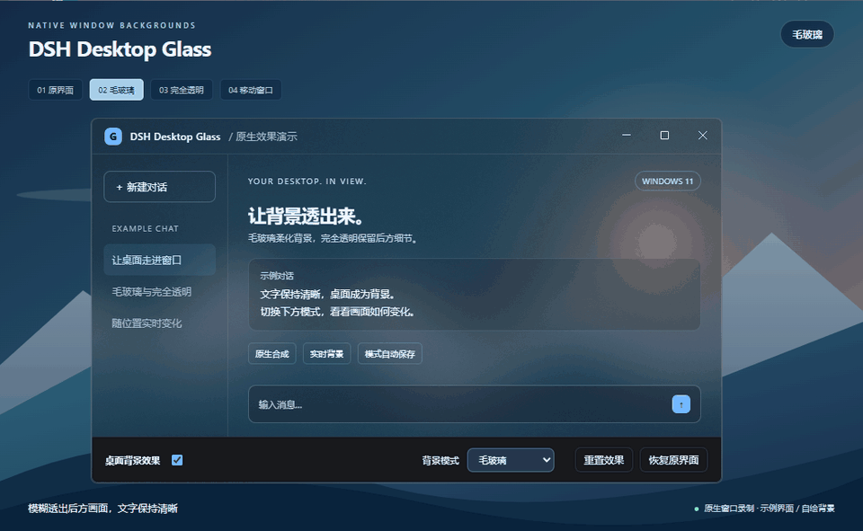

# DSH Desktop Glass

**Bring your desktop into DeepSeek Harness.**

Native **Acrylic / full transparency** for the Windows desktop app. Keep text opaque while the background updates with the content behind your window.

[Download v0.3.0 ZIP](https://github.com/inMessionante19/dsh-desktop-glass/releases/download/v0.3.0/dsh-desktop-glass-0.3.0.zip) · [中文](README.md) · [Releases](https://github.com/inMessionante19/dsh-desktop-glass/releases)



*10-second recording using the plugin's actual native effect and settings component. The separate demonstration window uses sample UI and original background artwork.*

| Mode | Effect |
| --- | --- |
| **Frosted glass** | Live Acrylic blur behind the window, with an optional 0–60% tint. |
| **Fully transparent** | No background blur or tint; directly shows the content behind the window. |

The mode is saved automatically. Text and icons stay opaque, and menus and dialogs keep a readable fill. Wallpaper Engine content can show through when it is behind the window and playing.

> **A manual native adapter setup is required.** Installing the UI bundle through a plugin market does not install the native adapter. Without it, the plugin keeps the original opaque UI and displays a setup notice.

## Requirements

- Windows 11 22H2 or later, with system transparency effects enabled.
- Verified with **DeepSeek Harness 0.2.1-rc.2 / Electron 44.7.0**. Other desktop builds may need adaptation.
- Node.js 20 or later to run the native installer.

This is a community plugin, unaffiliated with DeepSeek.

## Install

1. Download and extract the ZIP, or clone this repository. Fully exit Harness through its **system tray → Exit** menu.
2. Open PowerShell above the extracted plugin folder. Set the directory containing `DeepSeek Harness.exe`, then install the native adapter:

```powershell
$appDir = 'C:\path\to\DeepSeek Harness'
$pluginDir = (Resolve-Path '.\dsh-desktop-glass').Path
node (Join-Path $pluginDir 'native\install.mjs') --app-dir $appDir
```

3. If the UI plugin is not already installed through a market, add it to the desktop profile:

```powershell
$dshCli = Join-Path $appDir 'resources\runtime\cli\bin\dsh.cmd'
$pluginLink = 'link:' + ($pluginDir -replace '\\', '/')
& $dshCli plugin --profile desktop add $pluginLink
```

Keep the plugin folder when using a linked installation. If your launcher customizes `DSH_HOME`, set the same `$env:DSH_HOME` in this terminal. For `ERR_PNPM_UNEXPECTED_STORE`, append `--store-dir '<existing store path>'` using the path from the error.

4. Launch Harness normally. Open **Settings → General → 桌面背景效果** and choose **毛玻璃** (frosted glass) or **完全透明** (fully transparent). These plugin settings currently use Chinese labels.

**Ctrl + Alt + G** toggles the selected effect. **恢复原界面** restores the opaque UI immediately.

## Restore

Fully exit Harness, then use the paths from installation:

```powershell
node (Join-Path $pluginDir 'native\install.mjs') --app-dir $appDir --restore
```

The installer backs up and verifies the original archive. It modifies only the main/preload bridge files inside `resources/app.asar` and refuses to overwrite a changed desktop build with an old backup. Desktop updates may overwrite the adapter; rerun setup after exiting, or wait for an adapter update if the new build is unsupported.

Other applications behind Harness will also show through. Wallpaper Engine playback follows its own pause settings. Power saving, remote desktop and system transparency settings can limit native composition.

## Development

`npm test` runs dependency-free archive and IPC validation tests. Native appearance still needs Windows desktop verification. See the [Chinese documentation](README.md) for implementation details, tested behavior and historical releases.

Feedback is welcome in [Issues](https://github.com/inMessionante19/dsh-desktop-glass/issues). If this plugin helps your desktop setup, a Star helps others discover it.

[MIT License](LICENSE).
